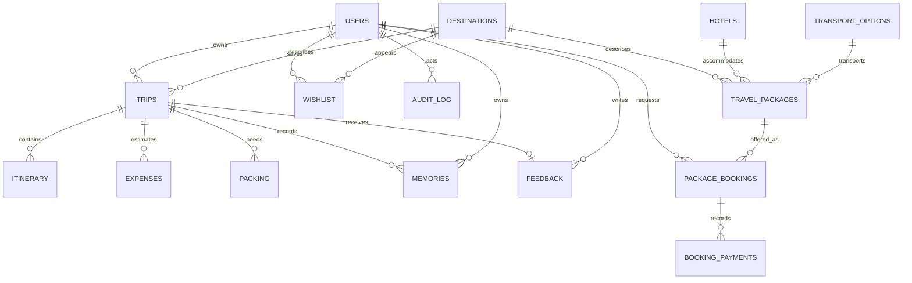

# Architecture

## MVC boundaries

- **View:** `WEB-INF/app.jsp` supplies the HTML document. Bootstrap, `app.css`, `app.js` and `packages.js` render the client/admin views and submit JSON through same-origin requests. JSP is private under `WEB-INF` and reached through the page controller.
- **Controller:** `PageController` serves the JSP and browser security headers. `ApiController` validates sessions, roles, CSRF tokens, request formats and dispatches actions. `RequestGuard` provides bounded per-IP request limits.
- **Model/service:** `TripService` enforces ownership, dates, statuses, item limits, budget precision and transactional trip generation. `PackageService` owns package publication, booking snapshots and the simulated payment ledger. `Security` implements password validation, PBKDF2 hashing and secure random tokens.
- **DAO:** `Database` manages the HikariCP connection pool, prepared JDBC statements, schema bootstrap and catalog seeds. All result sets/statements/connections are closed. Writes roll back on failures.

This is a Servlet/JSP MVC application with a JavaScript view layer, not a frontend-only simulation. Client data is stored in MySQL in production, not browser local storage.

## Data relationships

Other tables: `settings`, `login_attempts`, `schema_version`, `web_sessions`.

## Security behavior

- Passwords: PBKDF2-HMAC-SHA256, 600,000 iterations, unique 16-byte salts, constant-time derived-key comparison.
- Authentication: cookie-only 30-minute sessions, session-ID rotation after login, HttpOnly and SameSite=Lax cookies. HTTPS deployment configuration adds Secure.
- Authorization: database-backed current user status and role on each request; explicit owner predicates on trips, photos and memories; no client-provided user IDs trusted.
- CSRF: random session token required for every POST, including login/logout. Writes require JSON; no state-changing GET routes.
- Injection: prepared SQL parameters; internal allowlist for table identifiers. HTML values escaped before interpolation. CSP prohibits inline scripts, external code, objects and framing.
- Photo uploads: maximum 3 MB input/20 million pixels, normalized JPEG output up to 1600 pixels, metadata stripped, private owner-checked retrieval. No executable uploads or public file paths.
- Abuse limits: persisted eight-attempt/15-minute account login limit; per-instance IP limits for reads/writes/auth; external rate limiting included in nginx example.
- Password changes and disabled accounts invalidate sessions through `auth_version`. Administrators cannot modify other administrators through the client-access controls.
- Error responses do not expose SQL, stack traces, passwords or personal records. Access-log example omits query strings.

## Performance envelope

Connection pool: 5 maximum per instance (configurable), 0 minimum idle. Query timeout: 10 seconds. API body cap: 4.4 MB. User limits: 200 trips, 200 memories; each trip supports 500 entries per itinerary/packing/expense list. Photos are fetched separately from metadata and lazy-loaded. Assets are local; no production CDN dependency. All money uses decimal values server-side.

This is sized as a small-to-medium single-instance planning application. The current catalog/query cap is 1,000 rows; admin account and feedback screens paginate 50 records at a time, audit shows the latest 100. Larger deployments should add indexed full-text catalog search before exceeding these stated limits. Sessions are shared through MySQL with hashed session keys and 30-minute expiry; scale-out requires aggregate connection budgeting and edge rate limits.
